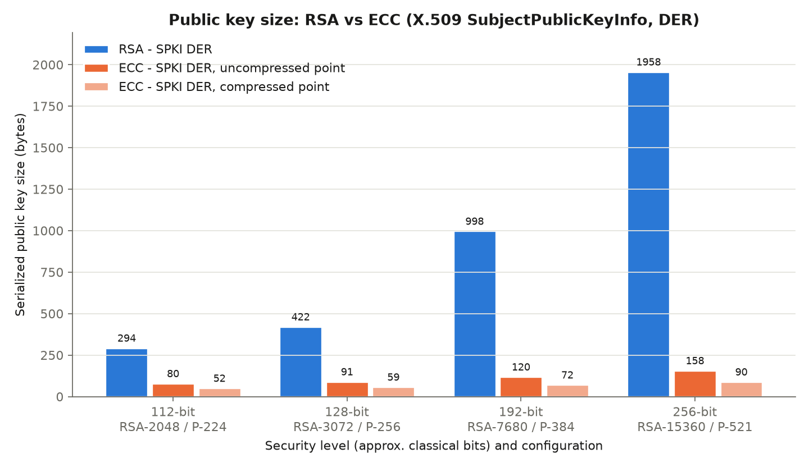
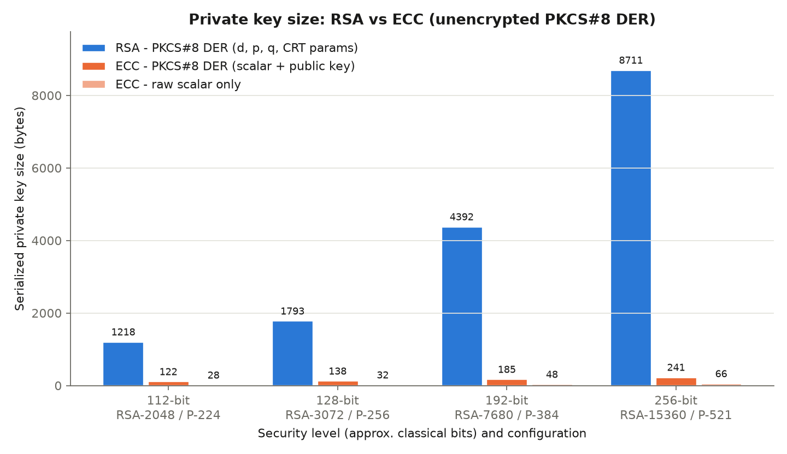
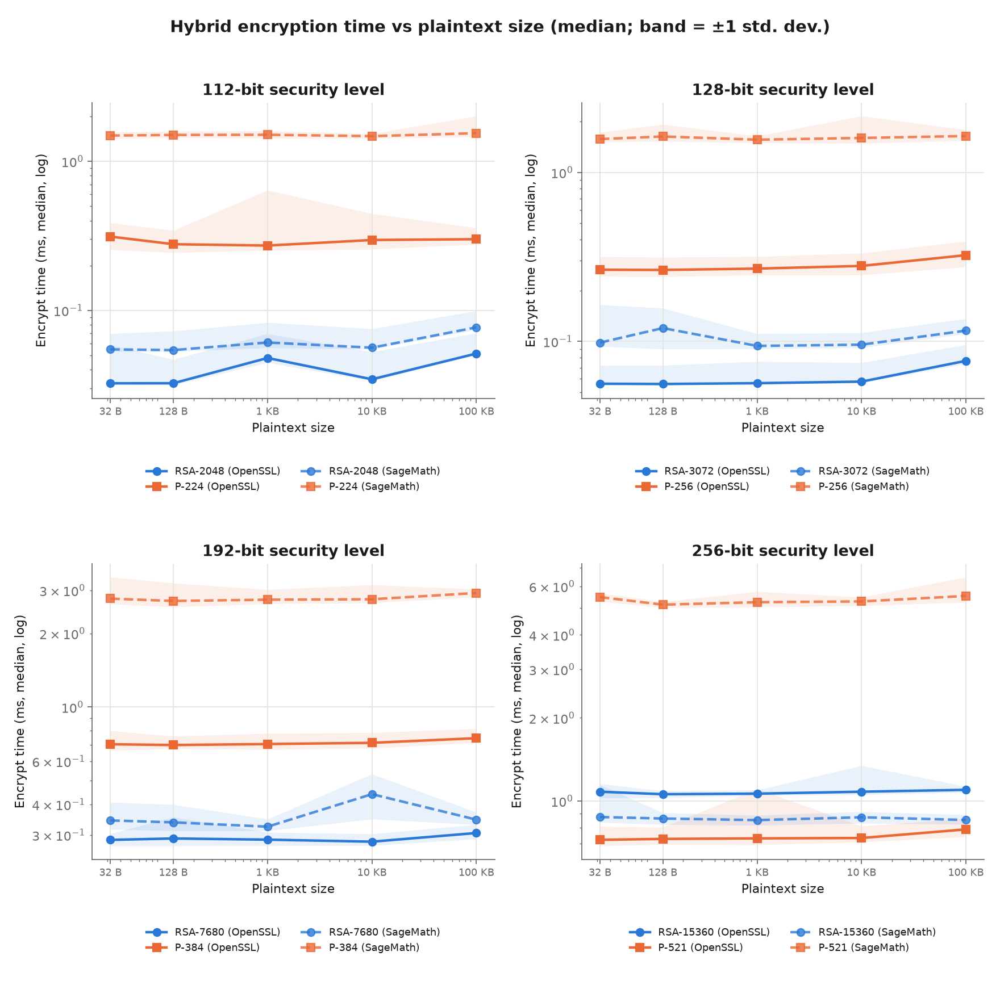
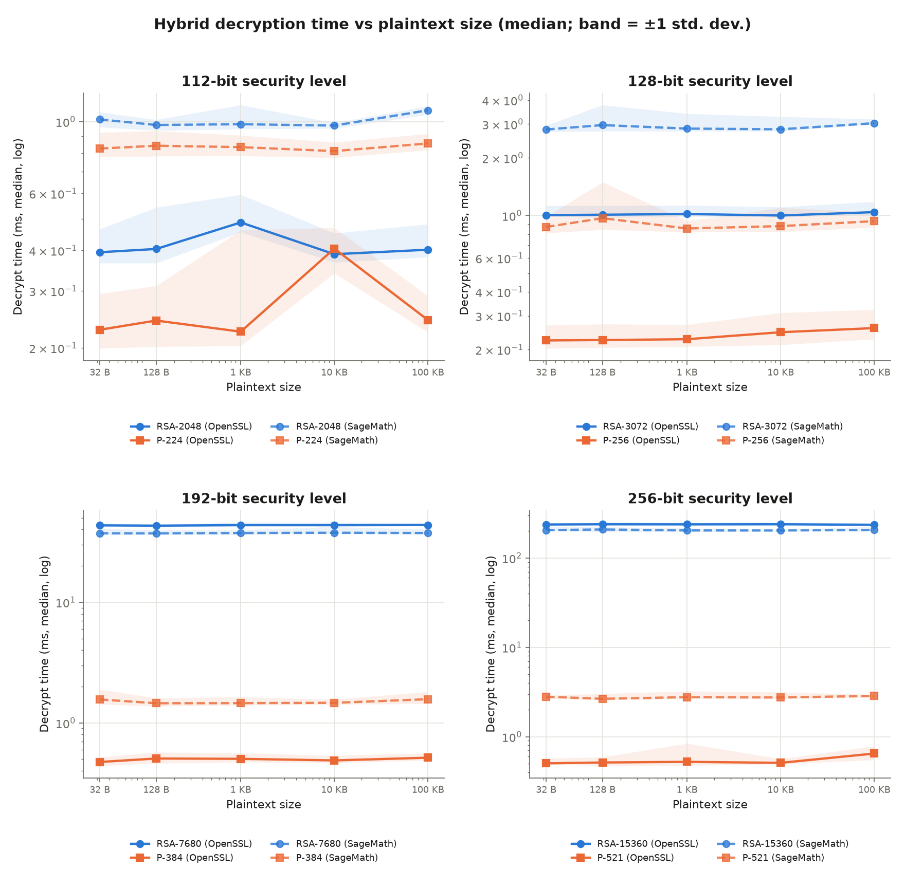
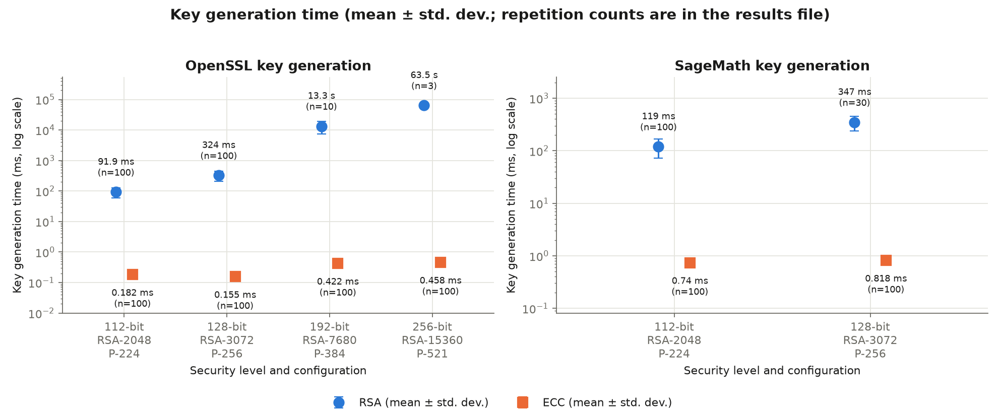
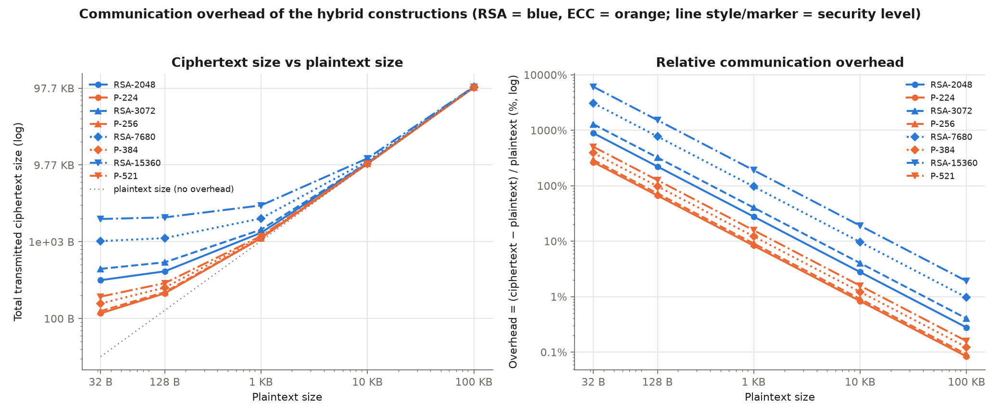
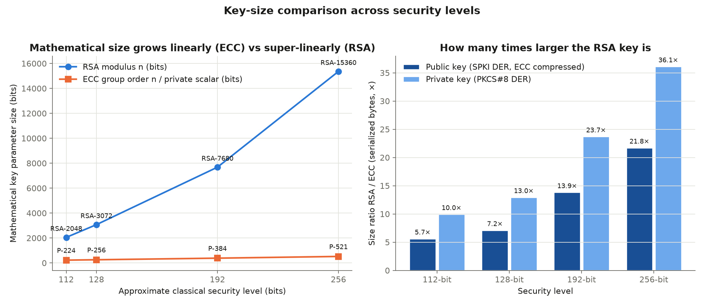

# RSA vs Elliptic-Curve Cryptography - implementation and measurement with SageMath

## For the results summary please find it at /results/results_summary.md
## To run the code, clone the repo, then run the pip install command, and see the available runs below (python main.py math/keysizes...)
```code
pip install -r requirements.txt
```
A working, tested and benchmarked comparison of **RSA** (RSA-OAEP / SHA-256, plus an RSA-OAEP + AES-256-GCM hybrid)
and **ECC** (NIST P-curves, with an *ECIES-style* ECDH + HKDF-SHA256 + AES-256-GCM hybrid), at four
approximately equivalent classical security levels.  Everything reported below was produced by the code in this
directory; no number or graph is hard-coded.

> **Educational project.** It has not been security-audited.  The `sage` backends are not constant-time.
> For real systems use a vetted library/protocol (e.g. HPKE, TLS, age) rather than this code.

---------------------------------------------------------------------

## Contents

1. [Quick start](#1-quick-start)
2. [Architecture and compatibility decisions](#2-architecture-and-compatibility-decisions)
3. [Mathematical foundations](#3-mathematical-foundations)
4. [The implemented constructions, exactly](#4-the-implemented-constructions-exactly)
5. [Experimental methodology](#5-experimental-methodology)
6. [Results](#6-results)
7. [Comparative analysis](#7-comparative-analysis)
8. [Limitations and security considerations](#8-limitations-and-security-considerations)
9. [Tests](#9-tests)

---------------------------------------------------------------------

## 1. Quick start

### Installation

SageMath is a large system.  Two supported ways to obtain `from sage.all import ...`:

**A. pip / virtualenv (used to develop and test this project; no root needed)**

```bash
python3 -m venv sagevenv && source sagevenv/bin/activate
pip install -r requirements.txt        # passagemath-standard, cryptography, matplotlib, pytest
python -c "from sage.all import GF; print(GF(23))"      # sanity check
```
`passagemath-standard` is the pip-installable distribution of SageMath's library.  Install took about
3.5 minutes (large binary wheels) and the first `import sage.all` takes ~1.2 s.  Wheels exist for Linux and macOS; on
Windows use WSL2.  Tested with Python 3.13, passagemath-standard 10.8.14, cryptography 50.0.1, matplotlib 3.11.2.

**B. Conda / mamba (full SageMath)**

```bash
mamba create -n sage sage python=3.12 -c conda-forge
mamba activate sage
pip install cryptography matplotlib pytest      # if not already present
```
Then run every command below as `sage -python main.py ...` (or with the env's `python`).

### Compatibility issues identified up front

| Issue | Decision |
|---|---|
| `.sage` files are pre-parsed by Sage (`^` = power, `1/2` = rational, integer literals become `Integer`).  They **cannot be imported by pytest or by other Python modules**. | All source is plain Python using the Sage library (`from sage.all import ...`).  This keeps modules importable/testable and avoids the preparser's `^` and integer-division traps.  Run with `sage -python` or a venv. |
| Sage's `random_prime`, `randint`, `ZZ.random_element` are simulation PRNGs (seeded Mersenne-Twister family). | Never used for secrets.  All keys, nonces and ephemeral scalars come from `os.urandom` / `secrets` (OS CSPRNG) via `common.py`.  Sage's seeded RNG is used only for the *toy* ECDLP curves. |
| Primality proofs: Sage proves primality by default (slow for 7680/15360-bit values). | `proof.arithmetic(False)` in `common.py` -> BPSW pseudoprime tests.  RSA primes additionally pass 8 random-base Miller-Rabin rounds. |
| `cryptography` cannot generate/load SubjectPublicKeyInfo with *compressed* EC points. | The compressed SPKI (needed for the compressed key-size measurement) is built with a small DER encoder in `ecc.py` and verified byte-for-byte against OpenSSL for the uncompressed case and by re-parsing with `cryptography` for the compressed case. |
| Sage's pure-Python-level elliptic-curve arithmetic is ~30x slower than OpenSSL's hand-optimised P-256 code. | Two interchangeable **backends** (see below), always benchmarked separately - never mixed. |
| Pure prime search for RSA-15360 would take many minutes per key. | RSA key *generation* benchmarks use OpenSSL for all levels, and Sage's own search for 112/128-bit only.  Keys for the enc/dec benchmarks are made once, outside every timer. |
| NIST curve constants. | Real standardized parameters (taken from OpenSSL's built-in definitions, then re-verified in Sage: p prime, n prime, G on curve, nG = O, h = 1, Hasse bound; SEA point counting #E = n for P-256) - see `tests/test_ecc.py` and `python main.py math`. |

### Running

```bash
python main.py                      # default demo: RSA-3072 vs P-256, same message, side by side
python main.py demo --level 192     # any of 112 / 128 / 192 / 256
python main.py interactive          # menu-driven: pick algorithm, keys, encrypt, show ciphertext, decrypt, verify ...
python main.py math                 # ECC mathematics: field, curve, G, order, add, double, kG, ECDLP on toy curves
python main.py keysizes             # key-size analysis table
python main.py benchmark --profile quick     # ~20 seconds (levels 112, 128; 20 repetitions)
python main.py benchmark --profile full      # all four levels, >=100 repetitions where practical (~20 min on the 2-vCPU test machine; RSA-15360 key generation dominates)
python main.py graphs               # redraw the 7 PNGs in graphs/ from results/benchmark_results.json
python main.py all --profile full   # keysizes + benchmark + graphs
cd tests && python -m pytest -q     # 140 tests
```

### Project layout

```
RSA_ECC_Comparison/
  README.md  requirements.txt
  main.py            CLI: demo, interactive menu, math demo, key sizes, benchmark, graphs
  common.py          security-level table, OS-CSPRNG helpers, AES-256-GCM helpers, DecryptionError
  rsa.py             Sage prime search + RSA keygen; RSA-OAEP (OpenSSL and Sage/own-OAEP); RSA-OAEP+AES-GCM hybrid
  ecc.py             Sage finite field / curve / G / order; explicit add, double, double-and-add;
                     SEC1 point (de)coding with validation; key pairs; DER/PEM serialization; toy ECDLP (BSGS)
  ecies.py           ECIES-style hybrid: ephemeral ECDH + HKDF-SHA256 + AES-256-GCM
  keysizes.py        mathematical vs serialized vs transmitted key sizes, reduction percentages
  benchmark.py       timing harness, profiles, Markdown report generator
  visualization.py   the 7 matplotlib graphs (read results JSON only)
  tests/             test_rsa.py, test_ecc.py, test_encryption.py, conftest.py
  results/           benchmark_results.json, results_summary.md, key_sizes.json, benchmark_run.log
  graphs/            1_public_key_sizes.png ... 7_keysize_across_levels.png
```
Deviations from the suggested layout: `.py` instead of `.sage` (reason above), and a separate `keysizes.py` and
`common.py` so that the key-size analysis and shared secure-randomness/AES code each live in one place.

---------------------------------------------------------------------

## 2. Architecture and compatibility decisions

```
             +---------------- main.py (CLI) ----------------+
             |  demo | interactive | math | keysizes | benchmark | graphs
             +--+---------+-----------+-----------+-----------+
                |         |           |           |
            rsa.py     ecies.py     ecc.py     keysizes.py   benchmark.py ---> visualization.py
          (RSA-OAEP,   (ECDH+HKDF+  (Sage F_p, (sizes)       (timing)           (PNG graphs)
           hybrid)      AES-GCM)     E, G, n)
                \         |          /
                 +------ common.py ------+   OS CSPRNG, AES-256-GCM, security levels
```

**Backends.** Each hybrid scheme has two backends that implement only the *public-key primitive*; HKDF, AES-GCM,
serialization and the wire format are shared, so the backends interoperate (tested in all four enc/dec pairings):

| | `openssl` (via `cryptography`) | `sage` |
|---|---|---|
| RSA | OAEP + modular exponentiation in OpenSSL | own RFC 8017 OAEP encoder + Sage/GMP `powermod`, CRT decryption |
| ECC | ECDH in OpenSSL | scalar multiplication with Sage's elliptic-curve group law |
| Purpose | realistic, hardened performance; primary comparison | shows the mathematics; second, independent measurement |
| Constant-time | designed to be | **no** |

RSA key generation always runs through Sage number theory (`rsa.py`): random odd candidates with the top two bits
set (so `n` has exactly the requested size), a small-prime `gcd` sieve, Fermat base 2, Baillie-PSW and 8 random-base
Miller-Rabin rounds, `gcd(p-1, e) = 1`, and `|p - q| > 2^(k/2-100)`.  The key is then loaded into `cryptography`,
which independently validates `p*q = n` and `d*e = 1 (mod p-1), (mod q-1)`.

---------------------------------------------------------------------

## 3. Mathematical foundations

### 3.1 RSA

Choose two large random primes p, q and set

$$n = pq,\qquad \varphi(n) = (p-1)(q-1),\qquad e = 65537 = 2^{16}+1,\qquad d \equiv e^{-1} \pmod{\varphi(n)}.$$

Public key (n, e); private key d (with p, q kept for speed).  For a message representative m with 0 <= m < n:

$$c = m^{e} \bmod n \quad\text{(encrypt)},\qquad m = c^{d} \bmod n \quad\text{(decrypt)}.$$

*Why it works.* ed = 1 + k*phi(n), so by Euler's theorem (and the CRT when gcd(m, n) > 1)
m^(ed) = m * (m^phi(n))^k = m (mod n).

*Why it is hard to break.* Recovering d from (n, e) is equivalent to factoring n.  The best classical factoring
algorithm, the General Number Field Sieve, is sub-exponential:

$$L_n\!\left[\tfrac13,\ \left(\tfrac{64}{9}\right)^{1/3}\right]=\exp\!\Big(\big((64/9)^{1/3}+o(1)\big)(\ln n)^{1/3}(\ln\ln n)^{2/3}\Big).$$

*CRT decryption (used by both RSA backends).*  With d_p = d mod (p-1), d_q = d mod (q-1), q_inv = q^(-1) mod p:

$$m_p=c^{d_p}\bmod p,\quad m_q=c^{d_q}\bmod q,\quad m=m_q+q\big(q_{inv}(m_p-m_q)\bmod p\big),$$

two exponentiations with half-size moduli and exponents, roughly 3-4x faster than one full exponentiation.

*Why textbook RSA is never used for data.*  c = m^e is deterministic (equal plaintexts give equal ciphertexts),
multiplicatively malleable ((m1 m2)^e = c1 c2) and breaks for small m.  **RSA-OAEP** (RFC 8017) first encodes

$$DB = \mathrm{lHash}\,\|\,0\ldots0\,\|\,\texttt{01}\,\|\,M,\quad \text{seed}\xleftarrow{\$}\{0,1\}^{256},\quad
EM = \texttt{00}\,\|\,(\text{seed}\oplus \mathrm{MGF1}(\text{maskedDB}))\,\|\,(DB\oplus\mathrm{MGF1}(\text{seed})),$$

with SHA-256 and MGF1-SHA-256.  The fresh random seed randomizes the ciphertext, and the redundancy (lHash, the zero
string, the `01` separator) makes forged ciphertexts fail to decode.  Capacity:
`k - 2*hLen - 2 = k - 66` bytes for a k-byte modulus (190 B for RSA-2048, 318 B for RSA-3072, 894 B for
RSA-7680, 1854 B for RSA-15360).  Arbitrary-length messages therefore need the hybrid construction (3.6).

### 3.2 Elliptic curves

Over a prime field F_p, a short Weierstrass curve is

$$E:\; y^2 = x^3 + ax + b \pmod p,\qquad 4a^3+27b^2\neq 0,$$

together with a point at infinity **O**.  The points form an abelian group under the chord-and-tangent rule
(`ecc.py: point_add / point_double`, cross-checked against Sage's own group law in the tests):

* **Addition** P1 = (x1, y1) != +-P2 = (x2, y2):

$$\lambda=\frac{y_2-y_1}{x_2-x_1},\qquad x_3=\lambda^2-x_1-x_2,\qquad y_3=\lambda(x_1-x_3)-y_1 .$$

* **Doubling** 2P1 (y1 != 0):

$$\lambda=\frac{3x_1^2+a}{2y_1},\qquad x_3=\lambda^2-2x_1,\qquad y_3=\lambda(x_1-x_3)-y_1 .$$

* P + (-P) = O where -(x, y) = (x, -y); O is the identity.

**Scalar multiplication** kP = P + ... + P (k terms) is computed by *double-and-add* in ~log2(k) doublings and
~log2(k)/2 additions on average (`Curve.scalar_mult`: process the bits of k from the top, double, and add P when the
bit is 1).  A 256-bit scalar needs ~256 doublings, not 2^256 additions.

**Domain parameters.** A curve is used with a base point G of large prime order n and cofactor h = #E / n.  For all
four NIST prime curves used here a = -3 and h = 1, so *every* non-identity point has prime order n.  P-256 (secp256r1):
p = 2^256 - 2^224 + 2^192 + 2^96 - 1, n = 0xffffffff00000000ffffffffffffffffbce6faada7179e84f3b9cac2fc632551.

**ECDLP.**  Key pair: private scalar d in [1, n-1], public point Q = dG.  The *elliptic-curve discrete logarithm
problem* is: given G and Q, find d.  Computing Q from d is cheap (double-and-add); the reverse has no known
sub-exponential algorithm for these curves.  The best generic algorithms (baby-step giant-step, Pollard's rho) need
about sqrt(pi n / 4) ~ sqrt(n) group operations, i.e. ~2^(m/2) for an m-bit group order.
`python main.py math` demonstrates this on small *toy* curves (clearly labelled, not P-256): each 4 extra bits of
group order multiplies baby-step giant-step time by about 4x.  For P-256, sqrt(n) ~ 2^128 steps.

### 3.3 ECDH key agreement

Alice has (a, A = aG), Bob has (b, B = bG).  Both can compute the same point:

$$S = aB = a(bG) = (ab)G = b(aG) = bA .$$

An eavesdropper sees A and B but would have to solve the computational Diffie-Hellman problem on E.  The shared
secret is the x-coordinate of S.  In ECIES-style encryption the sender simply uses a fresh ephemeral key (r, R = rG)
for every message.

### 3.4 Why the raw ECDH output is not used as a key: HKDF

x(S) is a ~256-bit *field element*, not a uniformly random bit string (e.g. it is always below p and its distribution
is structured), and the same x could be reused in different contexts.  **HKDF** (RFC 5869) with SHA-256 fixes both:

$$\mathrm{PRK}=\mathrm{HMAC}_{\text{salt}}(\mathrm{IKM}),\qquad K=\mathrm{HKDF\text{-}Expand}(\mathrm{PRK},\ \mathrm{info},\ 32).$$

*Extract* concentrates the entropy of IKM = x(S) into a pseudorandom key; *Expand* derives the 256-bit AES key and
`info` **binds the key to its context** (protocol identifier, curve name, ephemeral public key R and recipient
public key Q), so the same ECDH output could not yield the same key in another protocol or for another key pair.

### 3.5 AES-GCM authenticated encryption

AES-256-GCM encrypts in counter mode and authenticates ciphertext and *associated data* (AAD) with GHASH,
returning a 128-bit tag T.  Decryption recomputes the tag and releases plaintext only if it matches, giving
confidentiality **and** integrity/authenticity (IND-CCA-style protection for the symmetric layer).  AES without
authentication would be malleable (flipping ciphertext bits flips plaintext bits), so it is not used anywhere.
GCM requires that a (key, nonce) pair never repeat; here each message uses a *fresh, single-use key* (derived from a
fresh ephemeral key, or a fresh random AES key), so a random 96-bit nonce is safe.

### 3.6 Hybrid encryption

Public-key operations are expensive and size-limited (RSA-OAEP: <= k-66 bytes), while symmetric AEAD is fast and
unbounded.  A **hybrid** scheme therefore uses the public-key part only to establish a fresh symmetric key
(a *key encapsulation*), then encrypts the data with AES-GCM:

* RSA: `K` random -> `RSA-OAEP(pk, K)` is the encapsulation.
* ECC: `R = rG` (ephemeral public point) plus ECDH + HKDF give `K` at both ends - the encapsulation is `R`.

This is why RSA-OAEP and the ECIES-style scheme are compared **as hybrids** rather than "raw RSA vs raw ECC":
raw ECC has no direct encryption primitive (ECDH only agrees on a secret; EC "encryption" needs a symmetric
layer), raw RSA-OAEP cannot encrypt arbitrary-length data, and the practical question - what does it cost to send
an authenticated, confidential message of length L to a holder of a public key - is answered only by the hybrids.

### 3.7 Why ECC needs smaller keys at the same classical security

The two problems have attacks of very different efficiency.  Factoring has the sub-exponential GNFS, so the modulus
must grow *faster than linearly* in the desired security: going from 112-bit to 256-bit security multiplies the RSA
modulus by 7.5 (2048 -> 15360 bits) but the ECC field by only 2.3 (224 -> 521 bits).  For well-chosen elliptic curves
the only known classical attacks are *generic* square-root algorithms (rho) whose cost is 2^(m/2), so security grows
*linearly* with the field size: an m-bit group order gives about m/2 bits of security.  Hence NIST's approximate
equivalences (SP 800-57 Part 1):

| Security strength | RSA modulus | ECC curve (field / order size) |
|---|---|---|
| 112-bit | RSA-2048 | P-224 (224 bit) |
| 128-bit | RSA-3072 | P-256 (256 bit) |
| 192-bit | RSA-7680 | P-384 (384 bit) |
| 256-bit | RSA-15360 | P-521 (521 bit) |

These are *approximate classical equivalences*, not exact guarantees: they depend on cost models for the best known
attacks, change as cryptanalysis advances, and ignore quantum computers.  Shor's algorithm would break both RSA and
ECC in polynomial time, so **neither is quantum-safe**.

---------------------------------------------------------------------

## 4. The implemented constructions, exactly

### 4.1 RSA hybrid (`rsa.py`)

```
Encrypt(pk, M):  K <- 32 random bytes (OS CSPRNG)
                 E  = RSA-OAEP-SHA256(pk, K)            (k bytes; label empty; MGF1-SHA-256)
                 nonce <- 12 random bytes
                 (C, T) = AES-256-GCM_K(nonce, M, AAD = "RSA-ECC-Comparison/RSA-OAEP-AES256GCM/v1" || E)
                 output = E || nonce || C || T          (overhead: k + 12 + 16 bytes)
Decrypt(sk, output): split -> K = RSA-OAEP-decrypt(E) -> AES-GCM verify+decrypt. Any failure -> DecryptionError.
```

### 4.2 ECIES-style hybrid (`ecies.py`)

This is **an ECIES-style construction defined for this project.  It does not claim compliance with SEC 1,
IEEE 1363a, ISO 18033-2 or any other ECIES specification** (they differ in KDF inputs, MAC/DEM choices and encodings).

```
Recipient: d in [1, n-1], Q = dG.
Encrypt(Q, M):  validate Q (encoding, coordinates < p, on curve, not O)
                r <- uniform [1, n-1] (OS CSPRNG);  R = rG;  S = rQ;  Z = x(S) as fixed-length big-endian bytes
                K = HKDF-SHA256(ikm = Z, salt = none (32 zero bytes),
                                info = lp("RSA-ECC-Comparison/ECIES-style/ECDH-HKDF-SHA256-AES256GCM/v1")
                                    || lp(curve name) || lp(R, uncompressed SEC1) || lp(Q, uncompressed SEC1),
                                L = 32)                 lp(x) = 2-byte big-endian length || x
                nonce <- 12 random bytes
                (C, T) = AES-256-GCM_K(nonce, M, AAD = protocol-id || header)      header = R as transmitted
                output = header || nonce || C || T       header = SEC1 point: 65 B (P-256 uncompressed) or 33 B (compressed)
Decrypt(d, output): parse header (length from prefix byte), validate R, S = dR, Z, K as above, AES-GCM verify + decrypt.
```
* Private scalars and ephemeral scalars come from the OS CSPRNG; a scalar outside [1, n-1] is rejected.
* An off-curve, wrong-length, out-of-range or infinity point is rejected before any scalar multiplication
  (defence against invalid-curve attacks); since h = 1 any on-curve point has prime order n.
* The exact header bytes are authenticated (AAD), so re-encoding R, e.g. uncompressed -> compressed, is detected.
* All decryption failures raise the same `DecryptionError`, giving no oracle on *why* decryption failed.
* Total overhead: 65 + 12 + 16 = 93 B (P-256 uncompressed) or 61 B (compressed).

---------------------------------------------------------------------

## 5. Experimental methodology

* **Clock and statistics.** `time.perf_counter_ns` (monotonic); garbage collection disabled inside the timed loop;
  per-operation samples in ms; mean, median, sample standard deviation, min and max are stored in
  `results/benchmark_results.json`.  Each timed callable is run `warmup` times first and those runs are discarded.
* **Separation of concerns.** Key generation is a separate benchmark.  Keys for encryption/decryption timing are
  created once beforehand; Sage curve objects (`GF(p)`, `EllipticCurve`) are constructed before any timer starts
  (`get_curve` cache), so initialisation is not billed to any operation.
* **Identical plaintexts.** 32 B, 128 B, 1 KB (1024), 10 KB (10240), 100 KB (102400): deterministic SHA-256-counter
  bytes, byte-for-byte the same for RSA and ECC and across runs.
* **Compared constructions.** RSA-OAEP(SHA-256) + AES-256-GCM vs ephemeral ECDH + HKDF-SHA256 + AES-256-GCM, at
  matched security levels only (RSA-2048/P-224, RSA-3072/P-256, RSA-7680/P-384, RSA-15360/P-521).
* **Operations timed:** `encrypt` (fresh randomness every call), `decrypt` (fixed pre-generated ciphertext),
  `roundtrip` (encrypt then decrypt in one timed call = "total execution time" per message) and `keygen`.  The
  "one-shot total" additionally adds mean key-generation time.
* **Repetitions.** enc/dec: 100 for the 112/128/192-bit levels and 50 for the 256-bit level (RSA-15360 decryption
  takes hundreds of ms).  Key generation: ECC 100 everywhere; RSA via OpenSSL 100 (RSA-2048/3072), 10 (RSA-7680), 3
  (RSA-15360); RSA via Sage's own prime search 100 (RSA-2048), 30 (RSA-3072); Sage keygen at 192/256-bit is skipped
  (minutes per key).  RSA key generation time is intrinsically highly variable (random prime search), so use
  mean/median and the standard deviation, and note the very small *n* at 192/256-bit.  Every row records its `reps`.
* **Sizes.** Serialized sizes are `len()` of actual DER/PEM/SEC1 encodings of generated keys; ciphertext sizes are
  `len()` of actual outputs.  Mathematical sizes are bit lengths of the underlying integers.
* **Secrets.** Benchmark output never prints keys, scalars or session keys (checked by a test).
* **Environment caveat.** Measurements come from a shared 2-vCPU cloud container; absolute times will differ on your
  machine and run-to-run noise exists (see the standard deviations).  The *ratios* and orderings are the meaningful part.
  Run `python main.py benchmark --profile full` to reproduce on your hardware.

### Key-size terminology used throughout

1. **Mathematical size** - bits of the mathematical objects (RSA: n, e, d, p, q, CRT values; ECC: point coordinates, scalar).
2. **Serialized size** - bytes of a concrete encoding: X.509 SubjectPublicKeyInfo DER for public keys, unencrypted
   PKCS#8 DER for private keys, raw SEC1 points / raw scalar where named.  RSA PKCS#8 sizes vary by a few bytes between
   keys (DER integers drop leading zeros).
3. **Transmission size** - what you must send for someone to encrypt to you: the public-key SPKI DER (or its PEM text).

Reduction = (RSA size - ECC size) / RSA size * 100, computed for public and private keys separately and always
between the same kind of quantity (SPKI vs SPKI, PKCS#8 vs PKCS#8, public bits vs public bits).

---------------------------------------------------------------------

## 6. Results

All figures below are measured outputs of `python main.py all --profile full` (raw data:
`results/benchmark_results.json`; regenerate the tables with `benchmark.markdown_report`).  Timing noise exists:
look at the standard deviations, not only the medians.

### 6.1 Graphs (`graphs/`)

| # | File | Shows |
|---|---|---|
| 1 | `1_public_key_sizes.png` | serialized public key bytes (SPKI DER): RSA vs ECC uncompressed vs ECC compressed, 4 levels |
| 2 | `2_private_key_sizes.png` | serialized private key bytes (PKCS#8 DER; plus raw ECC scalar), 4 levels |
| 3 | `3_encryption_time.png` | encryption time vs plaintext size, one panel per security level, OpenSSL (solid) and SageMath (dashed) backends |
| 4 | `4_decryption_time.png` | decryption time vs plaintext size, same layout |
| 5 | `5_keygen_time.png` | key-generation time (log scale, mean ± std. dev., repetition count labelled) |
| 6 | `6_ciphertext_overhead.png` | ciphertext size and relative overhead vs plaintext size |
| 7 | `7_keysize_across_levels.png` | mathematical key size across levels, and RSA/ECC serialized-size ratio |









### 6.2 Tables

*Run: 2026-11-21 02:24:20 UTC, profile `full`, Python 3.13.18, SageMath 10.8.14, cryptography 50.0.2, 2 CPUs, Linux-6.18.44-fc-v726-x86_64-with-glibc2.39; total 1083.7 s.*

#### Serialized key sizes (bytes) and reduction of ECC relative to RSA

| Security | RSA | ECC | RSA public (SPKI DER) | ECC public (SPKI, uncompressed) | ECC public (SPKI, compressed) | Reduction (unc. / comp.) | RSA private (PKCS#8 DER) | ECC private (PKCS#8 DER) | Reduction | ECC raw scalar |
|---|---|---|---:|---:|---:|---:|---:|---:|---:|---:|
| 112-bit | RSA-2048 | P-224 | 294 | 80 | 52 | 72.8% / 82.3% | 1218 | 122 | 90.0% | 28 |
| 128-bit | RSA-3072 | P-256 | 422 | 91 | 59 | 78.4% / 86.0% | 1793 | 138 | 92.3% | 32 |
| 192-bit | RSA-7680 | P-384 | 998 | 120 | 72 | 88.0% / 92.8% | 4392 | 185 | 95.8% | 48 |
| 256-bit | RSA-15360 | P-521 | 1958 | 158 | 90 | 91.9% / 95.4% | 8711 | 241 | 97.2% | 66 |

#### Other serialized forms (bytes)

| Security | RSA public PKCS#1 `{n,e}` | RSA public PEM | ECC public PEM | ECC SEC1 point (unc. / comp.) | RSA private PEM | ECC private PEM |
|---|---:|---:|---:|---:|---:|---:|
| 112-bit | 270 | 451 | 162 | 57 / 29 | 1704 | 221 |
| 128-bit | 398 | 625 | 178 | 65 / 33 | 2484 | 241 |
| 192-bit | 974 | 1405 | 215 | 97 / 49 | 6002 | 306 |
| 256-bit | 1934 | 2705 | 268 | 133 / 67 | 11852 | 384 |

#### Mathematical key sizes (bits)

| Security | RSA public (n, e) | RSA private d | RSA private, all CRT parameters | ECC public point (unc. / comp.) | ECC private scalar | Reduction, public (unc. / comp.) | Reduction, private (d vs scalar) |
|---|---:|---:|---:|---:|---:|---:|---:|
| 112-bit | 2065 | 2045 | 7164 | 448 / 225 | 224 | 78.3% / 89.1% | 89.0% |
| 128-bit | 3089 | 3071 | 10749 | 512 / 257 | 256 | 83.4% / 91.7% | 91.7% |
| 192-bit | 7697 | 7680 | 26878 | 768 / 385 | 384 | 90.0% / 95.0% | 95.0% |
| 256-bit | 15377 | 15360 | 53758 | 1042 / 522 | 521 | 93.2% / 96.6% | 96.6% |

#### Key generation - OpenSSL backend (`cryptography`) - primary comparison

| Security | Config | Repetitions | Mean (ms) | Median (ms) | Std. dev. (ms) | Min (ms) | Max (ms) |
|---|---|---:|---:|---:|---:|---:|---:|
| 112-bit | RSA-2048 | 100 | 91.869 | 84.668 | 32.887 | 50.395 | 202.976 |
| 112-bit | P-224 | 100 | 0.182 | 0.169 | 0.043 | 0.155 | 0.511 |
| 128-bit | RSA-3072 | 100 | 324.272 | 289.627 | 114.074 | 170.779 | 659.242 |
| 128-bit | P-256 | 100 | 0.155 | 0.145 | 0.039 | 0.130 | 0.487 |
| 192-bit | RSA-7680 | 10 | 13319.817 | 12767.947 | 5983.167 | 6480.419 | 24068.204 |
| 192-bit | P-384 | 100 | 0.422 | 0.417 | 0.038 | 0.383 | 0.761 |
| 256-bit | RSA-15360 | 3 | 63477.588 | 63902.002 | 6190.450 | 57085.852 | 69444.910 |
| 256-bit | P-521 | 100 | 0.458 | 0.444 | 0.065 | 0.413 | 0.808 |

#### Encryption time, median ± std. dev. (ms) - OpenSSL backend (`cryptography`) - primary comparison

| Security | Config | Reps | 32 B | 128 B | 1 KB | 10 KB | 100 KB |
|---|---|---:|---:|---:|---:|---:|---:|
| 112-bit | RSA-2048 | 100 | 0.032 ± 0.026 | 0.032 ± 0.014 | 0.048 ± 0.022 | 0.034 ± 0.018 | 0.051 ± 0.019 |
| 112-bit | P-224 | 100 | 0.312 ± 0.075 | 0.278 ± 0.066 | 0.272 ± 0.368 | 0.296 ± 0.149 | 0.300 ± 0.057 |
| 128-bit | RSA-3072 | 100 | 0.056 ± 0.016 | 0.056 ± 0.016 | 0.057 ± 0.019 | 0.058 ± 0.017 | 0.077 ± 0.019 |
| 128-bit | P-256 | 100 | 0.265 ± 0.052 | 0.265 ± 0.051 | 0.270 ± 0.048 | 0.280 ± 0.053 | 0.324 ± 0.068 |
| 192-bit | RSA-7680 | 100 | 0.286 ± 0.017 | 0.290 ± 0.064 | 0.287 ± 0.021 | 0.282 ± 0.021 | 0.306 ± 0.026 |
| 192-bit | P-384 | 100 | 0.704 ± 0.096 | 0.699 ± 0.061 | 0.706 ± 0.075 | 0.714 ± 0.072 | 0.746 ± 0.070 |
| 256-bit | RSA-15360 | 50 | 1.080 ± 0.074 | 1.057 ± 0.030 | 1.062 ± 0.033 | 1.080 ± 0.263 | 1.097 ± 0.032 |
| 256-bit | P-521 | 50 | 0.722 ± 0.085 | 0.728 ± 0.075 | 0.731 ± 0.374 | 0.733 ± 0.077 | 0.788 ± 0.076 |

#### Decryption time, median ± std. dev. (ms) - OpenSSL backend (`cryptography`) - primary comparison

| Security | Config | Reps | 32 B | 128 B | 1 KB | 10 KB | 100 KB |
|---|---|---:|---:|---:|---:|---:|---:|
| 112-bit | RSA-2048 | 100 | 0.395 ± 0.071 | 0.404 ± 0.139 | 0.488 ± 0.107 | 0.389 ± 0.062 | 0.402 ± 0.080 |
| 112-bit | P-224 | 100 | 0.228 ± 0.067 | 0.243 ± 0.068 | 0.224 ± 0.238 | 0.405 ± 0.065 | 0.244 ± 0.046 |
| 128-bit | RSA-3072 | 100 | 1.005 ± 0.120 | 1.010 ± 0.116 | 1.018 ± 0.112 | 1.000 ± 0.108 | 1.042 ± 0.139 |
| 128-bit | P-256 | 100 | 0.223 ± 0.045 | 0.224 ± 0.047 | 0.227 ± 0.043 | 0.246 ± 0.065 | 0.259 ± 0.065 |
| 192-bit | RSA-7680 | 100 | 43.269 ± 1.707 | 43.044 ± 0.675 | 43.454 ± 2.413 | 43.446 ± 2.336 | 43.518 ± 1.920 |
| 192-bit | P-384 | 100 | 0.475 ± 0.044 | 0.507 ± 0.065 | 0.504 ± 0.059 | 0.489 ± 0.047 | 0.515 ± 0.048 |
| 256-bit | RSA-15360 | 50 | 236.922 ± 8.156 | 238.333 ± 12.369 | 237.865 ± 11.817 | 238.343 ± 11.652 | 235.159 ± 10.379 |
| 256-bit | P-521 | 50 | 0.503 ± 0.070 | 0.514 ± 0.078 | 0.523 ± 0.317 | 0.509 ± 0.056 | 0.647 ± 0.138 |

#### Total encrypt + decrypt (one timed call) time, median ± std. dev. (ms) - OpenSSL backend (`cryptography`) - primary comparison

| Security | Config | Reps | 32 B | 128 B | 1 KB | 10 KB | 100 KB |
|---|---|---:|---:|---:|---:|---:|---:|
| 112-bit | RSA-2048 | 100 | 0.424 ± 0.061 | 0.437 ± 0.103 | 0.543 ± 0.107 | 0.429 ± 0.071 | 0.466 ± 0.062 |
| 112-bit | P-224 | 100 | 0.544 ± 0.079 | 0.510 ± 0.074 | 0.504 ± 0.267 | 0.509 ± 0.054 | 0.555 ± 0.064 |
| 128-bit | RSA-3072 | 100 | 1.074 ± 0.107 | 1.068 ± 0.128 | 1.083 ± 0.108 | 1.080 ± 0.181 | 1.130 ± 0.119 |
| 128-bit | P-256 | 100 | 0.509 ± 0.057 | 0.514 ± 0.128 | 0.504 ± 0.054 | 0.530 ± 0.077 | 0.579 ± 0.074 |
| 192-bit | RSA-7680 | 100 | 44.305 ± 3.870 | 43.547 ± 0.997 | 43.667 ± 1.286 | 43.770 ± 1.045 | 44.045 ± 3.186 |
| 192-bit | P-384 | 100 | 1.174 ± 0.054 | 1.193 ± 0.073 | 1.217 ± 0.165 | 1.210 ± 0.138 | 1.284 ± 0.079 |
| 256-bit | RSA-15360 | 50 | 239.285 ± 8.407 | 237.782 ± 5.956 | 237.842 ± 5.055 | 240.970 ± 12.694 | 238.501 ± 10.024 |
| 256-bit | P-521 | 50 | 1.226 ± 0.074 | 1.238 ± 0.147 | 1.280 ± 0.512 | 1.239 ± 0.084 | 2.012 ± 0.299 |

#### Key generation - SageMath backend (own OAEP / elliptic-curve arithmetic) - educational implementation

| Security | Config | Repetitions | Mean (ms) | Median (ms) | Std. dev. (ms) | Min (ms) | Max (ms) |
|---|---|---:|---:|---:|---:|---:|---:|
| 112-bit | RSA-2048 | 100 | 119.368 | 110.334 | 47.334 | 60.759 | 264.648 |
| 112-bit | P-224 | 100 | 0.740 | 0.718 | 0.065 | 0.671 | 1.032 |
| 128-bit | RSA-3072 | 30 | 347.340 | 351.883 | 107.826 | 192.297 | 709.737 |
| 128-bit | P-256 | 100 | 0.818 | 0.758 | 0.143 | 0.690 | 1.273 |

#### Encryption time, median ± std. dev. (ms) - SageMath backend (own OAEP / elliptic-curve arithmetic) - educational implementation

| Security | Config | Reps | 32 B | 128 B | 1 KB | 10 KB | 100 KB |
|---|---|---:|---:|---:|---:|---:|---:|
| 112-bit | RSA-2048 | 100 | 0.055 ± 0.015 | 0.054 ± 0.019 | 0.061 ± 0.022 | 0.056 ± 0.019 | 0.077 ± 0.023 |
| 112-bit | P-224 | 100 | 1.487 ± 0.078 | 1.501 ± 0.091 | 1.505 ± 0.094 | 1.473 ± 0.058 | 1.542 ± 0.470 |
| 128-bit | RSA-3072 | 100 | 0.098 ± 0.066 | 0.120 ± 0.037 | 0.094 ± 0.017 | 0.096 ± 0.017 | 0.116 ± 0.021 |
| 128-bit | P-256 | 100 | 1.573 ± 0.155 | 1.629 ± 0.294 | 1.560 ± 0.081 | 1.597 ± 0.557 | 1.640 ± 0.146 |
| 192-bit | RSA-7680 | 100 | 0.344 ± 0.064 | 0.338 ± 0.062 | 0.324 ± 0.024 | 0.440 ± 0.092 | 0.346 ± 0.025 |
| 192-bit | P-384 | 100 | 2.773 ± 0.626 | 2.713 ± 0.499 | 2.746 ± 0.276 | 2.756 ± 0.403 | 2.924 ± 0.108 |
| 256-bit | RSA-15360 | 50 | 0.874 ± 0.269 | 0.863 ± 0.042 | 0.852 ± 0.036 | 0.872 ± 0.042 | 0.853 ± 0.039 |
| 256-bit | P-521 | 50 | 5.481 ± 0.193 | 5.146 ± 0.131 | 5.254 ± 0.492 | 5.287 ± 0.194 | 5.535 ± 0.948 |

#### Decryption time, median ± std. dev. (ms) - SageMath backend (own OAEP / elliptic-curve arithmetic) - educational implementation

| Security | Config | Reps | 32 B | 128 B | 1 KB | 10 KB | 100 KB |
|---|---|---:|---:|---:|---:|---:|---:|
| 112-bit | RSA-2048 | 100 | 1.015 ± 0.054 | 0.976 ± 0.038 | 0.982 ± 0.144 | 0.972 ± 0.019 | 1.084 ± 0.033 |
| 112-bit | P-224 | 100 | 0.826 ± 0.100 | 0.842 ± 0.095 | 0.834 ± 0.073 | 0.811 ± 0.052 | 0.856 ± 0.062 |
| 128-bit | RSA-3072 | 100 | 2.808 ± 0.143 | 2.961 ± 0.809 | 2.839 ± 0.560 | 2.815 ± 0.462 | 3.030 ± 0.149 |
| 128-bit | P-256 | 100 | 0.872 ± 0.115 | 0.969 ± 0.524 | 0.856 ± 0.082 | 0.881 ± 0.217 | 0.934 ± 0.107 |
| 192-bit | RSA-7680 | 100 | 37.195 ± 3.419 | 37.140 ± 2.475 | 37.410 ± 2.265 | 37.567 ± 4.554 | 37.393 ± 2.742 |
| 192-bit | P-384 | 100 | 1.564 ± 0.332 | 1.455 ± 0.151 | 1.458 ± 0.185 | 1.466 ± 0.100 | 1.572 ± 0.242 |
| 256-bit | RSA-15360 | 50 | 205.184 ± 20.495 | 208.277 ± 13.871 | 203.358 ± 12.281 | 202.976 ± 3.699 | 206.230 ± 18.627 |
| 256-bit | P-521 | 50 | 2.801 ± 0.124 | 2.653 ± 0.374 | 2.769 ± 0.467 | 2.746 ± 0.406 | 2.857 ± 0.112 |

#### Total encrypt + decrypt (one timed call) time, median ± std. dev. (ms) - SageMath backend (own OAEP / elliptic-curve arithmetic) - educational implementation

| Security | Config | Reps | 32 B | 128 B | 1 KB | 10 KB | 100 KB |
|---|---|---:|---:|---:|---:|---:|---:|
| 112-bit | RSA-2048 | 100 | 1.115 ± 0.026 | 1.048 ± 0.051 | 1.049 ± 0.043 | 1.036 ± 0.023 | 1.235 ± 0.351 |
| 112-bit | P-224 | 100 | 2.372 ± 0.161 | 2.396 ± 0.165 | 2.667 ± 0.556 | 2.304 ± 0.089 | 2.465 ± 0.231 |
| 128-bit | RSA-3072 | 100 | 2.937 ± 0.598 | 2.900 ± 0.129 | 2.944 ± 0.407 | 3.154 ± 0.490 | 2.993 ± 0.868 |
| 128-bit | P-256 | 100 | 2.623 ± 1.001 | 2.509 ± 0.219 | 2.432 ± 0.566 | 2.436 ± 0.078 | 2.560 ± 0.442 |
| 192-bit | RSA-7680 | 100 | 37.765 ± 6.230 | 37.553 ± 2.991 | 37.874 ± 4.087 | 37.518 ± 3.527 | 37.877 ± 4.646 |
| 192-bit | P-384 | 100 | 4.415 ± 0.841 | 4.208 ± 0.410 | 4.367 ± 0.435 | 4.185 ± 0.773 | 4.438 ± 0.131 |
| 256-bit | RSA-15360 | 50 | 205.688 ± 16.902 | 205.045 ± 10.149 | 207.950 ± 12.614 | 204.705 ± 10.018 | 205.055 ± 6.093 |
| 256-bit | P-521 | 50 | 8.282 ± 0.499 | 8.247 ± 0.512 | 7.980 ± 0.647 | 8.097 ± 0.185 | 8.775 ± 2.048 |

#### Mean encrypt / decrypt / round-trip (ms) at 1 KB, OpenSSL backend

| Security | Config | Encrypt mean | Decrypt mean | Round-trip mean | Keygen mean | One-shot total (keygen + round-trip) |
|---|---|---:|---:|---:|---:|---:|
| 112-bit | RSA-2048 | 0.054 | 0.511 | 0.565 | 91.869 | 92.434 |
| 112-bit | P-224 | 0.354 | 0.256 | 0.570 | 0.182 | 0.752 |
| 128-bit | RSA-3072 | 0.062 | 1.048 | 1.107 | 324.272 | 325.379 |
| 128-bit | P-256 | 0.278 | 0.233 | 0.513 | 0.155 | 0.668 |
| 192-bit | RSA-7680 | 0.289 | 44.066 | 44.104 | 13319.817 | 13363.921 |
| 192-bit | P-384 | 0.731 | 0.523 | 1.269 | 0.422 | 1.691 |
| 256-bit | RSA-15360 | 1.072 | 242.659 | 239.301 | 63477.588 | 63716.888 |
| 256-bit | P-521 | 0.869 | 0.608 | 1.439 | 0.458 | 1.897 |

#### Communication overhead (bytes added to the plaintext; measured from actual ciphertexts)

| Security | Config | Encapsulated key material | Nonce | Tag | Total overhead | Ciphertext for 32 B | for 1 KB | for 100 KB | Overhead at 32 B | at 1 KB | at 100 KB |
|---|---|---:|---:|---:|---:|---:|---:|---:|---:|---:|---:|
| 112-bit | RSA-2048 | 256 | 12 | 16 | 284 | 316 | 1308 | 102684 | 888% | 27.7% | 0.28% |
| 112-bit | P-224 | 57 | 12 | 16 | 85 | 117 | 1109 | 102485 | 266% | 8.3% | 0.08% |
| 128-bit | RSA-3072 | 384 | 12 | 16 | 412 | 444 | 1436 | 102812 | 1288% | 40.2% | 0.40% |
| 128-bit | P-256 | 65 | 12 | 16 | 93 | 125 | 1117 | 102493 | 291% | 9.1% | 0.09% |
| 192-bit | RSA-7680 | 960 | 12 | 16 | 988 | 1020 | 2012 | 103388 | 3088% | 96.5% | 0.96% |
| 192-bit | P-384 | 97 | 12 | 16 | 125 | 157 | 1149 | 102525 | 391% | 12.2% | 0.12% |
| 256-bit | RSA-15360 | 1920 | 12 | 16 | 1948 | 1980 | 2972 | 104348 | 6088% | 190.2% | 1.90% |
| 256-bit | P-521 | 133 | 12 | 16 | 161 | 193 | 1185 | 102561 | 503% | 15.7% | 0.16% |


---------------------------------------------------------------------

## 7. Comparative analysis

Numbers in this section are medians (or stated means) from the tables above; "x" = ratio RSA / ECC unless noted.
Timings: OpenSSL backend, 1 KB plaintext, 100 repetitions (50 at the 256-bit level; 10 and 3 for RSA key generation at
192 and 256 bits).

### 7.1 Key sizes - ECC is much smaller, and the gap widens with security level

* **Public key (SPKI DER).**  RSA-2048/3072/7680/15360: 294 / 422 / 998 / 1958 B.  ECC P-224/256/384/521: 80 / 91 /
  120 / 158 B uncompressed (**72.8% / 78.4% / 88.0% / 91.9% smaller**) or 52 / 59 / 72 / 90 B compressed
  (**82.3% / 86.0% / 92.8% / 95.4% smaller**).  At the default 128-bit level: 422 B vs 91 B (59 B compressed).
* **Private key (unencrypted PKCS#8 DER).**  1218 / 1793 / 4392 / 8711 B vs 122 / 138 / 185 / 241 B:
  **90.0% / 92.3% / 95.8% / 97.2% smaller**.  (The raw ECC scalar is only 28 / 32 / 48 / 66 B; the RSA PKCS#8 holds
  n, e, d, p, q, d_p, d_q, q_inv - 10 749 bits at RSA-3072 - while the ECC PKCS#8 also embeds the public key.)
* **Mathematical sizes** show the same structure without encoding overhead: at 128-bit the RSA public key (n, e) is
  3089 bits vs 512 bits for an uncompressed P-256 point (83.4% reduction) or 257 bits compressed (91.7%); the RSA
  private exponent d is 3071 bits vs a 256-bit scalar (91.7%).  Public and private comparisons are made separately
  and like-for-like; comparing only the RSA modulus with the ECC private scalar would mix different kinds of object.
* The RSA/ECC ratio of serialized public keys grows from 5.7x (compressed, 112-bit) to 21.8x (256-bit); private keys
  from 10.0x to 36.1x - as predicted by sub-exponential factoring versus square-root ECDLP attacks (Section 3.7).

### 7.2 Performance - mixed, operation- and level-dependent (ECC is *not* faster at everything)

| OpenSSL backend, 1 KB | 112-bit | 128-bit | 192-bit | 256-bit |
|---|---|---|---|---|
| Key generation (median) | ECC 500x faster | ECC 2000x faster | ECC ~30 600x faster | ECC ~144 000x faster |
| **Encryption** | **RSA 5.7x faster** (0.048 vs 0.272 ms) | **RSA 4.7x faster** (0.057 vs 0.270 ms) | **RSA 2.5x faster** (0.287 vs 0.706 ms) | ECC 1.45x faster (0.731 vs 1.062 ms) |
| Decryption | ECC 2.2x faster | ECC 4.5x faster (0.227 vs 1.018 ms) | ECC 86x faster (0.504 vs 43.5 ms) | ECC 455x faster (0.523 vs 237.9 ms) |
| Round-trip (enc + dec) | ~equal (1.08x; difference within noise) | ECC 2.1x faster (0.504 vs 1.083 ms) | ECC 36x faster | ECC 186x faster |

* **Why RSA encryption is fast.**  With e = 65537 = 2^16 + 1 the public operation is 16 modular squarings and one
  multiplication - tiny compared with a full-size private exponent.  ECIES encryption must do *two* scalar
  multiplications (ephemeral key R = rG and shared point S = rQ) plus point validation, HKDF and serialization.
* **Why RSA decryption is slow and gets dramatically worse.**  It is a modular exponentiation with a modulus-sized
  exponent (even with CRT), whose cost grows roughly cubically with the modulus length (RSA-7680 -> RSA-15360:
  43 -> 238 ms).  ECC decryption is one scalar multiplication whose cost grows only a little faster than linearly
  with the field size, which is why the gap explodes at 192/256-bit.
* **Key generation.**  ECC keys cost one scalar multiplication (0.15-0.46 ms).  RSA must search for two large primes:
  92 ms (RSA-2048), 324 ms (RSA-3072), 13.3 s (RSA-7680), 63.5 s (RSA-15360) on average, with a large spread (the
  standard deviation is about a third of the mean at RSA-2048/3072 and ~45% at RSA-7680; RSA-15360 has only
  3 samples).  Whether this matters depends on how often keys are created.
* **Message size.**  For 32 B-100 KB the time is nearly flat: the public-key operation dominates, and AES-256-GCM adds
  only a few hundredths of a millisecond even at 100 KB (e.g. at 128-bit: +0.021 ms for RSA, +0.058 ms for ECC, mostly
  noise-level differences between 32 B and 100 KB medians).
* **Implementation matters (SageMath backend).**  Using Sage/GMP modular exponentiation and Sage's generic
  elliptic-curve arithmetic instead of OpenSSL changes the picture: at 128-bit, RSA-3072 round-trip 2.94 ms vs P-256
  2.43 ms (ECC only 1.21x faster, versus 2.15x with OpenSSL), and at 112-bit RSA-2048 is **2.5x faster overall**
  (1.05 vs 2.67 ms) because GMP's big-integer arithmetic is far better optimised than Sage's generic point
  arithmetic.  ECC decryption is still faster at every level (1.18x, 3.3x, 25.7x, 73x), and at 192/256-bit ECC wins
  every round-trip (8.7x, 26x).  Part of OpenSSL's P-256 speed comes from curve-specific optimised code (OpenSSL's
  other NIST curves are typically less optimised), so absolute ECC numbers at different levels are not equally
  well tuned.
* **One-shot total (keygen + one round trip, means, OpenSSL).**  RSA-2048 92.4 ms vs P-224 0.75 ms; RSA-3072
  325 ms vs P-256 0.67 ms; RSA-7680 13.4 s vs 1.7 ms; RSA-15360 63.7 s vs 1.9 ms.  Keygen dominates if keys are
  ephemeral; if a key pair is reused for many messages, only the per-message costs above matter.

### 7.3 Communication overhead (measured from real ciphertexts)

| 128-bit | RSA-3072 hybrid | P-256 ECIES-style |
|---|---|---|
| Encapsulated key material | 384 B | 65 B (33 B compressed) |
| Nonce + tag | 12 + 16 B | 12 + 16 B |
| **Total overhead** | **412 B** | **93 B** (61 B compressed) |
| 32-byte message -> ciphertext | 444 B (1288% overhead) | 125 B (291%) |
| 1 KB -> ciphertext | 1436 B (40.2%) | 1117 B (9.1%) |
| 100 KB -> ciphertext | 102 812 B (0.40%) | 102 493 B (0.09%) |

Overheads at the other levels: RSA 284 / 988 / 1948 B vs ECC 85 / 125 / 161 B (112 / 192 / 256-bit).  The overhead is
constant per message, so it only matters for short messages (tokens, key wrapping, IoT frames); above ~100 KB both
are below 2%.  The overhead of RSA equals the modulus size, so it grows with the security level; the ECC overhead
grows only with the curve size.

### 7.4 Advantages, disadvantages and practical implications

**ECC (P-curves, ECIES-style):**
* + 5.7-36x smaller keys; 3.3-12x smaller per-message overhead; far cheaper key generation and (at >= 128-bit) private-key
  operations; scales gracefully to 192/256-bit security - relevant for TLS handshakes, certificates, smart cards,
  IoT/embedded devices, mobile and server load with many private-key operations.
* - Encryption alone can be slower than RSA-OAEP with e = 65537 (here 2.5-5.7x at 112-192 bit); correct
  implementation is subtler (point validation, invalid-curve attacks, constant-time arithmetic); there is no single
  "ECIES" - interoperability requires fixing a profile (e.g. HPKE); trust questions about the NIST curve generation
  process are sometimes raised (curves such as Curve25519 are an alternative not examined here).

**RSA (OAEP, hybrid):**
* + Very fast public operation (encryption, signature verification); conceptually simple; ubiquitous legacy support.
* - Large keys and ciphertext overhead; slow, high-variance key generation; decryption cost grows super-linearly,
  which makes RSA-7680/15360 impractical (43 ms and 238 ms per decryption here); padding (OAEP) must be implemented
  carefully to avoid Manger-style oracles.

**Overall.**  At matched classical security ECC wins decisively on key size, bandwidth, key generation and private-key
cost, and the margin grows with the security level; RSA wins on public-key operation speed at 112-192 bits.  Which
matters depends on the workload (e.g. a server that mostly decrypts/signs favours ECC; a device that only encrypts to
a long-term public key and has no bandwidth limit may be fine with RSA).  **Neither provides post-quantum security**:
a sufficiently large quantum computer running Shor's algorithm breaks both, and new deployments should plan for
post-quantum KEMs (e.g. ML-KEM, FIPS 203), typically in hybrid with classical ECDH.

---------------------------------------------------------------------

## 8. Limitations and security considerations

* **Not audited / educational.**  The `sage` backends (own OAEP code, Sage group law, explicit double-and-add) are
  **not constant time** and must not be used on secrets in a hostile setting; the OAEP decoder cannot guarantee
  constant-time behaviour in Python.  The `openssl` backend is the realistic one.
* **Approximate equivalences.**  The 112/128/192/256-bit pairings are NIST SP 800-57 estimates for classical attacks
  (GNFS, Pollard rho); they are not exact and not valid against quantum adversaries.
* **Measurements.**  One machine type (shared 2-vCPU cloud container, Python 3.13, OpenSSL via `cryptography`),
  wall-clock timing with Python overhead (each call includes Python-level work such as HKDF object creation,
  point (de)serialization and, for Sage, object conversions - identical treatment for RSA and ECC).  Repetitions are
  below 100 for RSA key generation at 192-bit (10) and 256-bit (3) and for enc/dec at 256-bit (50); Sage-backend
  RSA key generation is only measured at 112/128-bit (100 and 30 repetitions).  Results can shift on other CPUs
  (especially with different OpenSSL builds and curve-specific assembly).  Single outliers occur (e.g. P-224
  decryption at 10 KB, P-521 round-trip at 100 KB); medians and standard deviations are given for that reason.
  Round-trip and separate encrypt/decrypt means are different sample sets and need not add up exactly.
* **Benchmark keys.**  RSA keys for enc/dec benchmarks at 192/256-bit come from OpenSSL's generator (wrapped into the
  same `RSAKeyPair`), because Sage's own search would take minutes per key; this affects only setup, not timed code.
* **Hybrid design.**  The ECC scheme is ECIES-*style* and *not* a standardized profile.  Both schemes use random
  96-bit GCM nonces with single-use keys (safe here); do not reuse these functions with long-lived symmetric keys.
  No sender authentication is provided (anyone with the public key can encrypt) - add signatures for that.
  No key-encryption at rest: `private_pem()`/`private_der()` are unencrypted PKCS#8 and exist only for measuring
  serialized size.  Plaintext length is not hidden.
* **Side channels and invalid input.**  EC points are fully validated; RSA ciphertext length is checked; every failure
  is reported with one generic `DecryptionError`.  Python cannot erase key material from memory.
* **Randomness.**  All secrets come from `os.urandom`/`secrets` (OS CSPRNG).  Sage's simulation RNG is used only for
  the toy ECDLP curves, whose parameters are not secret.
* **Toy curves** in the ECDLP demonstration are deliberately small random curves, labelled as such, and are never used
  to encrypt anything or presented as P-256.

---------------------------------------------------------------------

## 9. Tests

`cd tests && python -m pytest -q` runs 140 tests in ~10 s (Sage-generated RSA-2048 and P-256 keys are built once per session).

| Requirement | Tests |
|---|---|
| RSA / ECC encrypt-decrypt recover plaintext | `test_oaep_roundtrip_and_max_length`, `test_hybrid_roundtrip`, `test_ecies_roundtrip`, `test_both_systems_recover_identical_plaintext` |
| Binary and UTF-8 messages; empty and different lengths (0 B to 100 KB) | shared `MESSAGES` list (empty, 1 B, text, multi-byte UTF-8 with emoji, all 256 byte values, zeros, 1 KB, 100 KB), `test_utf8_text_and_binary_handled_by_both` |
| Randomized encryption (different ciphertexts) | `test_oaep_is_randomized`, `test_hybrid_randomized`, `test_ecies_randomized` (fresh R and nonce) |
| Modified ciphertexts fail authentication | `test_hybrid_every_region_is_authenticated`, `test_ecies_every_region_is_authenticated` (bit flip in each field), truncation/extension tests, `test_ecies_reencoded_ephemeral_key_breaks_tag` |
| Wrong private key fails | `test_oaep_wrong_key_fails`, `test_hybrid_wrong_key_fails`, `test_ecies_wrong_private_key_fails` |
| Invalid EC points rejected | `test_invalid_points_rejected` (off-curve, x or y >= p, zero point, bad prefix/length, infinity, non-square x), `test_point_on_a_different_curve_rejected`, `test_ecies_invalid_recipient_public_point_rejected`, `test_ecies_invalid_ephemeral_point_in_ciphertext_rejected` |
| Invalid / out-of-range private scalars rejected | `test_invalid_private_scalar_types_and_small_values`, `test_out_of_range_private_scalar_rejected` (0, -1, n, n+1, 2^300, non-integers, bool) |
| Real NIST parameters; math correctness | `test_domain_parameters_are_the_standard_ones` (all 4 curves; G equals OpenSSL's), `test_p256_known_constants`, `test_p256_full_point_count_equals_n` (SEA), `test_group_law_matches_sage`, `test_scalar_mult_group_properties` |
| Key generation / serialization | RSA math invariants, prime tests, SPKI DER identical to OpenSSL, compressed SPKI re-parsed by `cryptography`, PKCS#8 round trips, key sizes (65/33/91/59/32/138 B for P-256) |
| Secure randomness; no secrets printed; HKDF not raw ECDH | `test_keygen_uses_os_csprng_not_sage_prng`, `test_randomness_comes_from_os_csprng`, `test_no_secret_leak_in_benchmark_output`, `test_ecies_kdf_is_context_bound`, `test_ecies_session_key_is_hkdf_of_ecdh_not_raw`, `test_repr_hides_*` |
| Backend interoperability | all four enc/dec backend pairings for RSA-OAEP, RSA hybrid and ECIES (compressed and uncompressed R) |

The tests were also checked for sensitivity by deliberately breaking the code (disabling the on-curve check, using the
raw ECDH x-coordinate as the AES key, dropping the header from the GCM associated data): each mutation made the suite fail.

